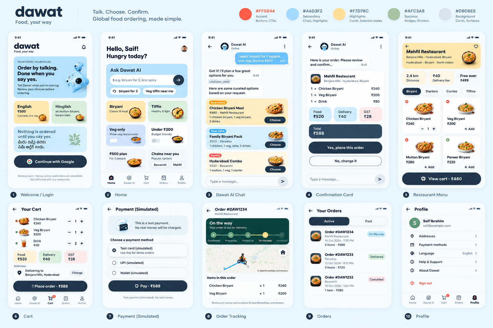
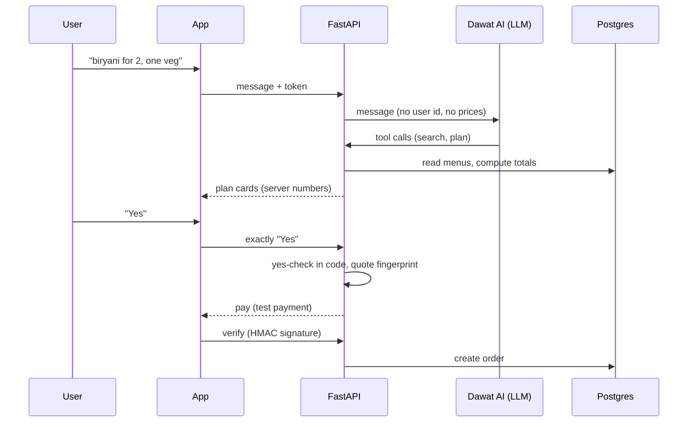
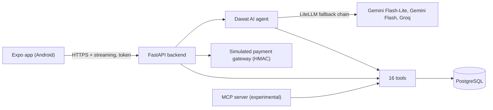

<div align="center">

# dawat

**Food, your way.** Order by talking. Nothing is ordered until you say yes.

An agentic food-ordering app for Hyderabad. Chat in **English, Hinglish or Telugu**, and Dawat AI plans the meal, fills the cart and waits for your clear confirmation.


<!-- Replace with a real screenshot collage: docs/screenshots/overview.png -->


</div>

> **Demo project.** Menus, prices, payments, users and orders are **simulated**. Restaurant names and locations are real, from OpenStreetMap. Not affiliated with any restaurant.

---

## What it does

Instead of scrolling menus, you talk to it the way you would to a friend:

| You say | Dawat AI understands |
|---|---|
| `Bro I'm hungry, ₹500, 2 people, one veg, something spicy, Madhapur` | Budget, group size, diet, spice and area, then three meal plans |
| `rendu kodi biryani, karam lekunda` | Two chicken biryanis, not spicy (Telugu, romanised) |
| `Shah Ghouse ki mutton biryani order kar do` | A specific dish at a specific restaurant (Hinglish) |

- **Meal plans for groups.** Three options (Best match, Best value, Variety). They never exceed the budget, always respect diets, and say so honestly when the request is impossible.
- **Browse like a normal food app.** Pick an area, see restaurants with distance and delivery fee, filter veg only, open a menu, add to cart.
- **Confirm, pay, track.** Review the bill, confirm, pay on a simulated test checkout, then follow the order on a timeline with a rider on an OpenStreetMap map.
- **Remembers only what you ask it to.** Preferences (diet, spice, area, language) are saved only on explicit request, shown in Profile, and can be edited or forgotten.

## Screens

<!-- Add your own screenshots from a real phone, for example:
<p>
  
  
  
  
</p>
-->

Welcome · Home · Dawat AI chat with plan cards · Confirmation card · Restaurant menu · Cart · Test payment · Order tracking · Orders · Profile

*Screenshots and a short demo video are coming. See `docs/design/` for the design reference.*

## The idea: the LLM understands, code decides

The model reads what you mean. **Code** decides everything that matters.

- **Prices, totals, fees and GST** come from the server, never from the model or the app.
- **Identity** comes only from a verified login token. The model never sees a user id.
- **Consent** is enforced in code: an order can only move forward after a clear "yes" to a confirmation card that the *server* rendered.
- **Diet rules** (a saved vegetarian is never silently given meat) are enforced in code and in database triggers.



## Architecture



| Layer | Tech |
|---|---|
| App | Expo (SDK 57), React Native, TypeScript, Expo Router |
| Backend | FastAPI (Python), server-sent events for chat streaming |
| Database | PostgreSQL 17 locally; Supabase Postgres + Auth for the hosted demo |
| AI | LiteLLM with Gemini Flash-Lite, then Gemini Flash, then Groq as fallbacks |
| Maps | Leaflet in a WebView with OpenStreetMap tiles |
| Tests | pytest (backend), Jest + Testing Library (app) |

## Engineering highlights

- **Consent that can't be skipped.** The confirmation card is rendered by the server. The card buttons send exactly `Yes` or `No` through the chat, and a "yes" only acts on the card shown in the previous reply. An adversarial "rule-breaker" agent attacked this over several rounds and found real bypasses, which were fixed by redesigning the flow, not by patching word lists.
- **Multilingual yes-check.** Handles English, Hinglish and Telugu (script and romanised), negation such as `karam kam`, and traps like `ok thanks` (not a yes), with an LLM intent check layered on strict code rules.
- **Honest meal planner.** Budget, vegetarian and spice rules are code. The planner never claims "cheapest" unless it can prove it.
- **Defence in depth.** Row-level security, database triggers for totals and diet promises, closed tool schemas, and a per-user rate limit.
- **Mutation-style testing.** Safety-critical code is tested with deliberately planted bugs to prove the tests catch them. The app side does the same for identity, cart and payment logic.
- **Real-device debugging.** Tested on two physical Android phones over USB, which found layout and state bugs that unit tests missed.
- **Free-tier discipline.** A menu cache, local-only test runs, and guard hooks that refuse to run tests against a remote database.

## Data

- **Restaurants:** about 1,100 restaurants and 1,300 branches in Greater Hyderabad, from [OpenStreetMap](https://www.openstreetmap.org/copyright), cleaned, deduplicated and grouped into chains with a reviewed mapping.
- **Menus and prices:** synthetic, about 24,000 items with English, Hinglish and Telugu aliases.
- Restaurant names and locations © OpenStreetMap contributors (ODbL).

## Project status

| Area | Status |
|---|---|
| Data pipeline, database, tools, planner, Dawat AI agent | Done and tested |
| Simulated payments and order tracking (backend) | Done and tested |
| Android app: sign-in, browse, menu, cart, chat, payment, tracking, orders, profile | Built, tested on two phones |
| iOS | Not tested |
| Google sign-in | Built for production; real sign-in needs the hosted setup, not yet live |
| Deployment, demo video | Planned |
| MCP server (browse and plan from an MCP client) | Experimental, in progress |

Last full runs: backend 2,200+ tests, app 330+ tests, 0 failures.

**Not in this demo:** real payments, real restaurant menus, real delivery, iOS builds, a public live link.

## Run it locally (Windows)

You need Python 3.12+, Node.js, PostgreSQL 17, and an Android phone with USB debugging (or an emulator).

```powershell
# 1. Backend (local PostgreSQL, loopback only)
python -m venv .venv
.venv\Scripts\pip install -r backend\requirements.txt
# create the local databases with backend\local_setup.py (see its --help)
.venv\Scripts\python backend\dev_server.py start

# 2. Phone over USB (nothing is exposed to your network)
adb reverse tcp:8000 tcp:8000
adb reverse tcp:8081 tcp:8081

# 3. App (local dev sign-in, loopback only)
cd mobile
npm install
npm run dev:local
```

Then open **Expo Go** on the phone, choose *Enter URL*, and enter `exp://localhost:8081`.

Test payment values: card `4111 1111 1111 1111` pays, `4000 0000 0000 0002` always fails. No real card numbers are accepted.

Copy `backend/.env.example` and `mobile/.env.example` to `.env` and fill them in yourself. Never commit them.

```powershell
# Tests
.venv\Scripts\python -m pytest backend\tests -q
cd mobile; npx tsc --noEmit; npm run lint; npx jest; npm run check:release
```

## Repository layout

```
backend/        FastAPI app, agent, planner, tools, migrations, tests
mobile/         Expo React Native app (the product)
data_pipeline/  OpenStreetMap fetch, cleaning, chain mapping, menu generation
evals/          Scripted conversation evals
docs/           API contract, mobile rules, build and device setup
frontend/       Legacy web frontend (not maintained)
frontend_old/   Earlier web frontend (read-only reference)
```

Useful docs: [`docs/API_CONTRACT.md`](docs/API_CONTRACT.md), [`docs/MOBILE_RULES.md`](docs/MOBILE_RULES.md), [`docs/MOBILE_DEVICE_SETUP.md`](docs/MOBILE_DEVICE_SETUP.md), [`docs/MOBILE_BUILD.md`](docs/MOBILE_BUILD.md).

## Roadmap

- Hosted demo (Render + Supabase) and a release APK
- Native Google sign-in
- Multi-restaurant orders and "order my usual"
- Voice ordering
- MCP server hand-off, so an MCP client can browse and plan
- 50+ scripted conversation evals with published failure cases

## How it was built

Built by me with [Claude Code](https://www.anthropic.com/claude-code) as the implementation assistant. I set the architecture and safety rules, reviewed the work, and approved each decision. The tests, planted-bug checks and device testing are there so the claims above don't rest on trust.

## License

Not yet chosen. Until one is added, all rights are reserved. Restaurant data derived from OpenStreetMap is subject to the [ODbL](https://opendatacommons.org/licenses/odbl/).

## Author

**Saif**, [GitHub](https://github.com/YOUR-USERNAME) · [LinkedIn](https://www.linkedin.com/in/YOUR-PROFILE)
